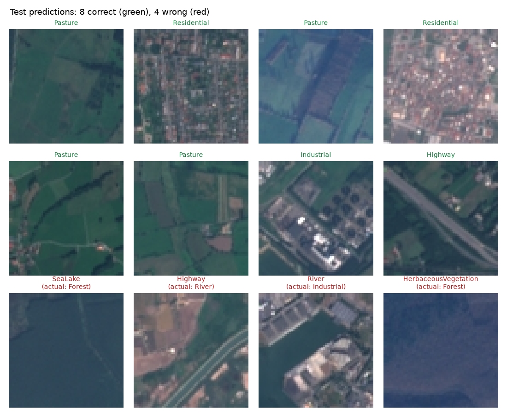
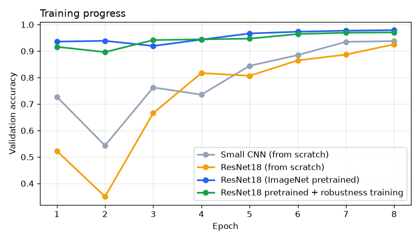
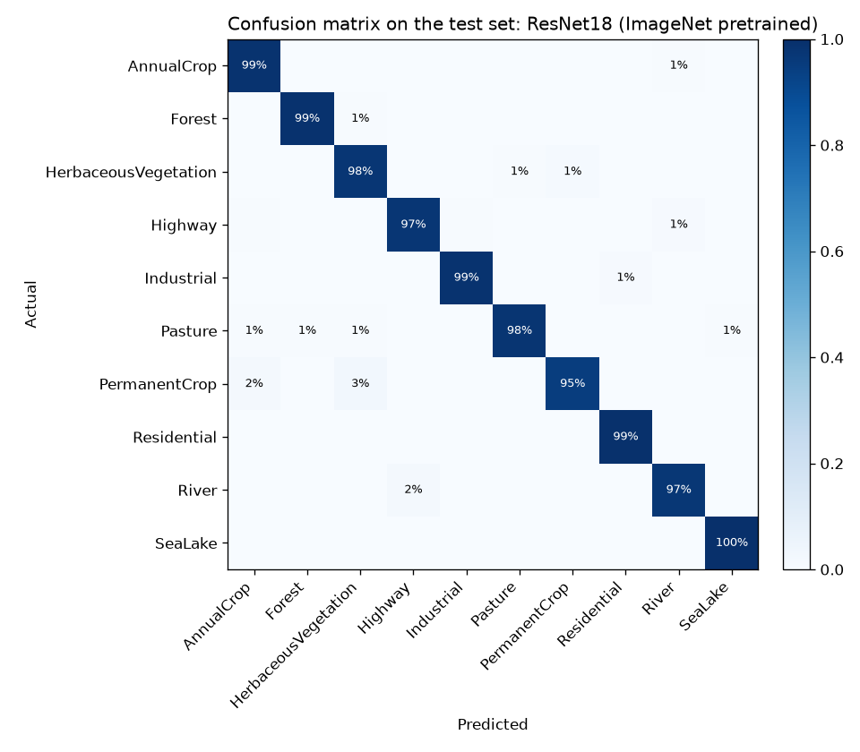
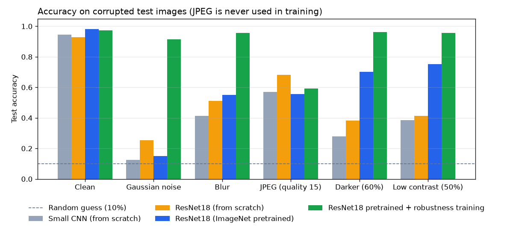

# Satellite Land-Use Classifier

[](https://github.com/eslammohibrahim/satellite-land-use-classifier/actions/workflows/tests.yml)

A PyTorch image classifier that labels satellite images with one of 10 land-use classes, served through a FastAPI web service. It includes a comparison of four models and a robustness study that found, and then fixed, a serious weakness.

**Results on 5,400 unseen test images:**
- **98.1% accuracy** with a fine-tuned ImageNet ResNet18. That's 5.3 points higher than the same network trained from scratch with the same budget.
- The standard model **collapses under image noise** (15% accuracy, close to the 10% you'd get by guessing). Training with realistic degradations raises that to **91.5%**, at a cost of 0.8 points on clean images.
- Robustness **doesn't carry over** to a corruption type the model never saw during training (JPEG compression). You have to train for the degradations you expect.



## Data

[EuroSAT RGB](https://huggingface.co/datasets/timm/eurosat-rgb) (MIT license): 27,000 Sentinel-2 satellite images, 64×64 pixels, 10 classes: AnnualCrop, Forest, HerbaceousVegetation, Highway, Industrial, Pasture, PermanentCrop, Residential, River, SeaLake.

- I used the official splits: 16,200 train, 5,400 validation, 5,400 test.
- I checked for leakage: no image ID or identical image appears in more than one split.
- The classes are slightly imbalanced (Pasture has 1,195 training images, Residential has 1,863), so I also report macro F1.
- The data isn't stored in the repo. `src/data.py` downloads it on first run.

## Approach

- **Same training budget for every model:** 8 epochs, AdamW, one-cycle learning rate schedule, label smoothing 0.05, CPU only.
- **Augmentation:** random flips and 90° rotations. Satellite images have no "up", so these give free extra data.
- **Model selection:** each model keeps its checkpoint with the best **validation** accuracy. The test set is used only for the final numbers.

## Results

| Model | Parameters | Training time (CPU) | Validation acc | Test acc | Test macro F1 | Latency per image (CPU) |
|---|---|---|---|---|---|---|
| Small CNN, from scratch | 0.4M | 4.9 min | 93.8% | 94.5% | 0.944 | about 2 ms |
| ResNet18, from scratch | 11.2M | 8.7 min | 92.5% | 92.7% | 0.926 | about 9 ms |
| **ResNet18, ImageNet pretrained** | 11.2M | 8.6 min | **97.9%** | **98.1%** | **0.980** | about 9 ms |
| ResNet18 pretrained + robustness training | 11.2M | 12.7 min | 97.1% | 97.2% | 0.972 | about 9 ms |



What this shows:
- **Transfer learning is the biggest win.** The pretrained ResNet18 reaches 93.6% validation accuracy after a single epoch. The same network trained from scratch needs all 8 epochs to get to 92.5%.
- **The small CNN beats ResNet18 from scratch with this budget.** A 28× larger model needs more data or more epochs than this to pay off. Both from-scratch curves are still rising at epoch 8, so the gap would likely narrow with longer training.

Per class (ResNet18 pretrained, test set):

| Class | Precision | Recall | F1 |
|---|---|---|---|
| AnnualCrop | 0.972 | 0.987 | 0.979 |
| Forest | 0.992 | 0.990 | 0.991 |
| HerbaceousVegetation | 0.959 | 0.976 | 0.967 |
| Highway | 0.974 | 0.974 | 0.974 |
| Industrial | 0.988 | 0.986 | 0.987 |
| Pasture | 0.977 | 0.977 | 0.977 |
| PermanentCrop | 0.981 | 0.946 | 0.963 |
| Residential | 0.989 | 0.995 | 0.992 |
| River | 0.983 | 0.972 | 0.977 |
| SeaLake | 0.990 | 0.998 | 0.994 |



The most common mistakes make sense visually:
- **PermanentCrop → HerbaceousVegetation** (16 images) and **PermanentCrop → AnnualCrop** (10): orchards and vineyards look like other green fields at 64×64 pixels.
- **River → Highway** (12): both are long, thin lines across the image.

## Robustness: finding and fixing a weakness

Real satellite images aren't always clean: there's sensor noise, haze, poor lighting, and compression. I tested every model on the test set under five corruptions:

| Corruption | Standard model | Robust model |
|---|---|---|
| None (clean) | 98.1% | 97.2% |
| Gaussian noise | **15.0%** | **91.5%** |
| Blur | 55.1% | 95.8% |
| Darker (60% brightness) | 70.2% | 96.3% |
| Low contrast (50%) | 75.3% | 95.7% |
| JPEG, quality 15 (*never seen in training*) | 55.6% | 59.3% |



- **The weakness:** on noisy images the standard model is barely better than guessing. EuroSAT images are low in contrast: pixel values within a typical image vary by only about 0.095 (on a 0–1 scale), and the test noise has a standard deviation of 0.08. So the noise is almost as strong as the image content itself.
- **The fix:** the robust model is the same pretrained ResNet18, trained with random noise, blur, brightness, and contrast changes added to the training images. It recovers to above 91% on every corruption it trained on.
- **The limit:** JPEG compression was deliberately kept out of training, to test whether robustness transfers to an unseen corruption. It barely does (55.6% → 59.3%).
- **The trade-off:** 0.8 points of clean accuracy in exchange for about 76 points under noise.

**Which model the API serves:** before looking at the test results, I set a rule: serve the robust model if its validation accuracy is within 0.5 points of the standard model. It came in 0.85 points lower, so the API serves the standard model by default. If the images you expect are noisy or low quality, the robust model is the better choice, and you can switch to it with one environment variable (see below).

## API

The model is served with FastAPI. `/predict` accepts an image of any size (it's resized to 64×64) and returns the top 3 classes.

```bash
curl -X POST http://127.0.0.1:8000/predict -F "file=@app/static/examples/residential.png"
```

```json
{"prediction":"Residential","confidence":0.9502,"top3":[{"label":"Residential","probability":0.9502},{"label":"SeaLake","probability":0.0069},{"label":"Highway","probability":0.0063}]}
```

| Endpoint | Description |
|---|---|
| `GET /` | Upload page with six example images to try |
| `POST /predict` | Classify an image: returns the prediction, confidence, and top 3 |
| `GET /health` | Service status |
| `GET /classes` | The 10 class names |
| `GET /docs` | Interactive API docs (Swagger) |

Error handling: a file that isn't an image returns `400`, and a file larger than 5 MB returns `413`.

Confidences top out around 95–96%. That's expected: label smoothing during training keeps the model from becoming overconfident.

## Run it

```bash
python -m venv .venv
.venv\Scripts\activate        # on macOS/Linux: source .venv/bin/activate
pip install -r requirements.txt

# Serve the trained model (downloaded automatically from this repo's release on first start)
uvicorn app.main:app
# Then open http://127.0.0.1:8000

# Serve the robust model instead
$env:MODEL_PATH="models/resnet18_robust.pt"    # PowerShell; on macOS/Linux: export MODEL_PATH=models/resnet18_robust.pt
uvicorn app.main:app

# Retrain and re-evaluate everything (about 40 minutes on CPU)
python src/train.py --model small_cnn
python src/train.py --model resnet18_scratch
python src/train.py --model resnet18_pretrained
python src/train.py --model resnet18_robust
python src/evaluate.py

pytest                        # API and data tests
```

### With Docker

```bash
docker build -t land-use-api .
docker run -p 8000:8000 land-use-api
```

The image includes the trained weights and runs as a non-root user. On every push, CI builds the image, starts it, and checks that it classifies an example image correctly.

The trained weights for both ResNet18 models are attached to the [v1.0 release](https://github.com/eslammohibrahim/satellite-land-use-classifier/releases/tag/v1.0).

## Project structure

```
src/
  data.py        download, decoding, caching, augmentation and corruption
  models.py      small CNN and ResNet18 variants
  train.py       training loop with best-checkpoint selection
  evaluate.py    test metrics, robustness tests, figures
app/
  main.py        FastAPI service
  static/        upload page and example images
tests/
  test_api.py    endpoints, predictions, error handling
  test_data.py   augmentation and normalization
reports/
  figures/       charts used in this README
  training/      per-epoch training history for each model
  results.json   all test and robustness metrics
```

## Next steps

- Add JPEG compression to robustness training, and test on other unseen corruptions (haze, clouds).
- Train longer and compare more architectures (EfficientNet, ConvNeXt-Tiny).
